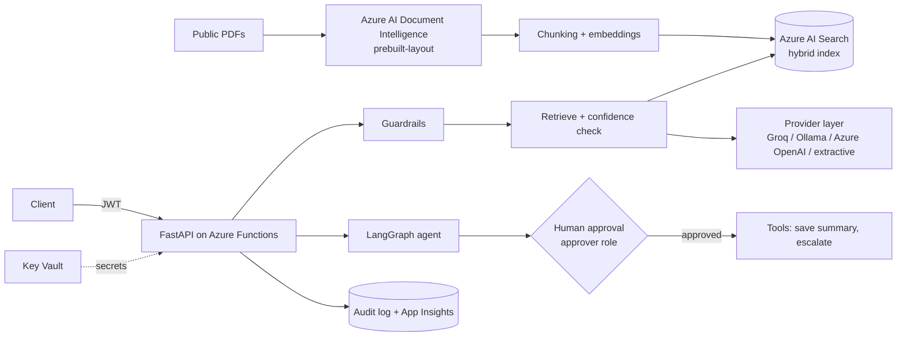

# Architecture

Request path for `/agent/run`: guardrails -> retrieval -> confidence gate (refuse if low) -> answer with
citations -> plan action -> **interrupt for approval** -> execute only if approved. Every step is audit-logged.

Known limitation: the agent's pending-approval state lives in an in-process `MemorySaver`. With several
Function instances, or after a restart, pending approvals are lost. Swap in a persistent LangGraph
checkpointer (for example Postgres or Cosmos DB based) before real use.
